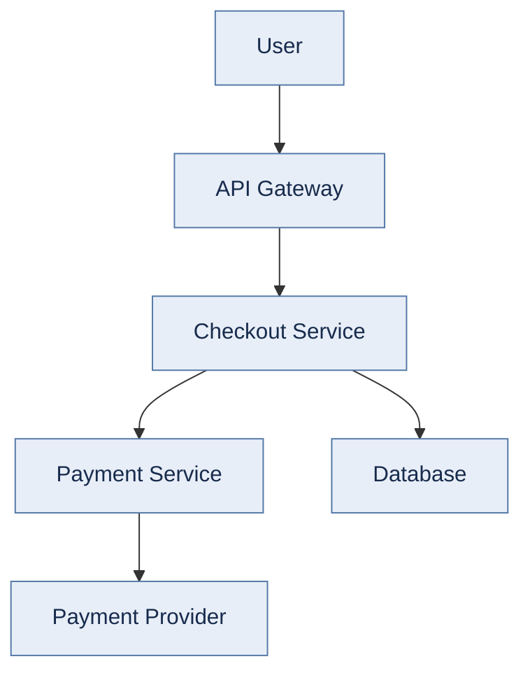
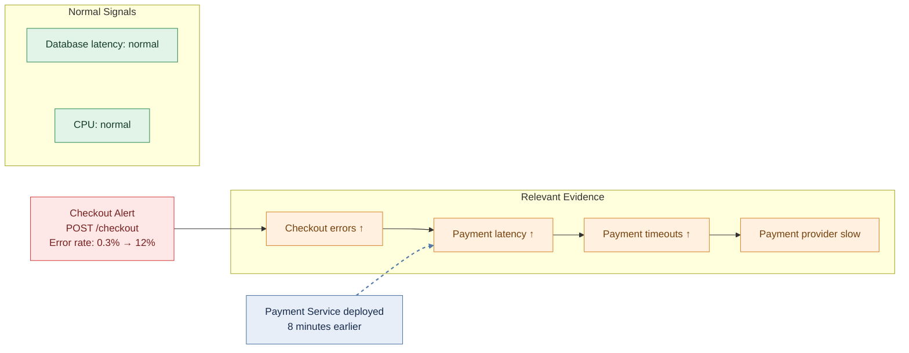
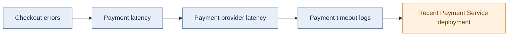
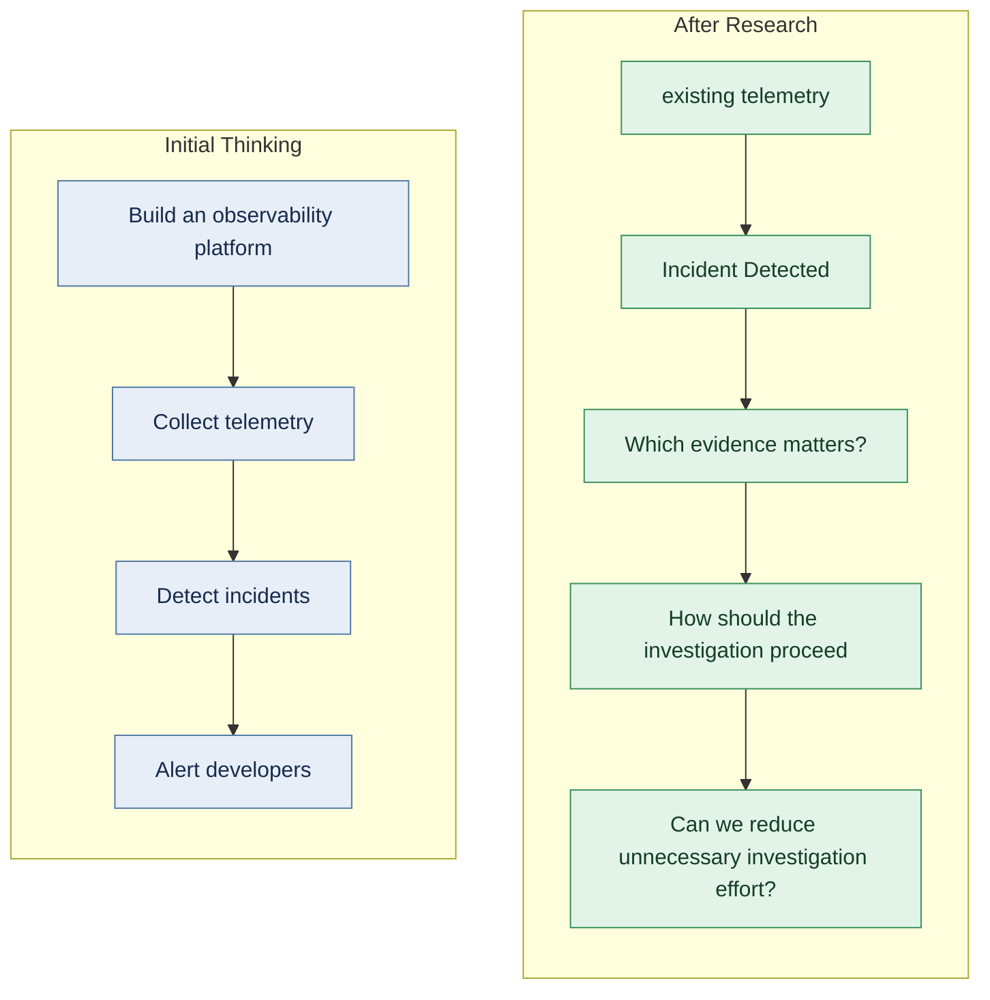

# Incident Investigation Research

> Independent research and learning into how developers detect, investigate, and reason about production incidents using logs, metrics, traces, and operational context.

**Status:** Ongoing research and learning

---

# Why I started this

While preparing for software engineering roles, I became interested in a practical engineering problem:

> **When a production system starts failing, how does a developer go from "something is wrong" to understanding what happened and where to investigate?**

My initial idea was to build a developer-focused observability and incident detection platform.

Before starting implementation, I decided to understand the problem, study existing solutions, and investigate how real production incidents are handled.

When an incident occurs, how do engineers decide which logs, metrics, traces, deployment events, and dependency signals are most relevant to investigating it?

The research changed my original thinking.

I found that modern observability platforms already provide extensive capabilities around metrics, logs, traces, alerting, incident management, application performance and increasingly automated investigation.


That led me to a narrower question:

> **Do developers still spend meaningful time determining which evidence is relevant during an incident, even when the telemetry already exists?**

This repository documents my learning, research, and evolving understanding of the problem

---

# What I wanted to understand

I structured the research around several questions:

1. What is observability?
2. How are logs, metrics, and traces different?
3. How does distributed tracing work?
4. What problem does OpenTelemetry solve?
5. How are real production incidents detected and investigated?
6. What tools already exist?
7. Where might developers still experience friction?
8. Which assumptions about the original idea were wrong?
9. Is there a problem worth solving?
10. What would a small, testable technical experiment look like?

---

# 1. Observability fundamentals

I started by learning the difference between monitoring and observability.

### Monitoring

Monitoring helps answer questions such as:

- Is the service healthy?
- Are errors increasing?
- Is latency increasing?
- Is traffic changing?
- Is the system approaching a resource limit?

A useful SRE model is the Four Golden Signals:

- Latency
- Traffic
- Errors
- Saturation

### Observability

Observability is about understanding the internal state and behavior of a system from the information it produces.
A simplified distinction I use in this research is:

```text
Monitoring
    ↓
"Is something wrong?"

Observability
    ↓
"What is happening inside the system?"

```

This does not mean observability automatically provides the root cause.
It provides evidence that can be used during investigation.

---

# 2. Logs, metrics, and traces

I learned that these signals answer different questions.

### Metrics

Metrics are numerical measurements observed over time.
Examples:

```text
request rate
error rate
latency
CPU usage
memory usage
queue depth

```

Common metric types include:

- Counter
- Gauge
- Histogram

Metrics are useful for understanding trends, detecting changes, and measuring system behavior.

### Logs

Logs are records of events.
A structured application log might contain:

```json
{
  "timestamp": "...",
  "level": "ERROR",
  "service": "payment-service",
  "endpoint": "/checkout",
  "trace_id": "...",
  "message": "payment provider timeout"
}

```

Structured logs make machine processing, filtering, and correlation easier.

### Traces

A distributed trace represents the path of a related operation through a system.
A trace contains spans.
For example:

```text
Checkout Request
│
├── API Gateway
│
├── Checkout Service
│
├── Payment Service
│
├── Payment Provider
│
└── Database

```

Each span represents an operation within that trace.
Trace IDs allow related telemetry to be correlated across services.

### The important lesson

These signals are complementary:

```text
Metrics
  → What changed?

Logs
  → What events occurred?

Traces
  → Where did time or failure occur in the request path?

```

None of them automatically explains the complete incident.
The value comes from combining relevant evidence.

---

# 3. OpenTelemetry

I then studied OpenTelemetry because I wanted to understand how modern applications generate and transport observability data.

OpenTelemetry is a vendor-neutral framework for instrumenting, generating, collecting, and exporting telemetry.

The concepts I studied include:

- Instrumentation
- OpenTelemetry API
- OpenTelemetry SDK
- Automatic instrumentation
- Context propagation
- OTLP
- OpenTelemetry Collector
- Receivers
- Processors
- Exporters

A simplified pipeline is:

```text
Application
    ↓
Instrumentation
    ↓
OpenTelemetry
    ↓
OTLP
    ↓
OpenTelemetry Collector
    ↓
Processing
    ↓
Observability backend

```

One important conclusion was:

> **OpenTelemetry provides telemetry infrastructure; it is not itself an incident diagnosis system.**

This distinction helped me separate telemetry collection from incident investigation.

---

# 4. Understanding incidents

I then separated several concepts that I initially treated too similarly.

### Error

An individual failure.

### Anomaly

Behavior that differs from an expected pattern.

### Incident

A significant problem that requires investigation or response.

### Symptom

What the system or user is experiencing.

### Cause

A factor contributing to the problem.

### Root cause

An underlying factor whose correction is intended to prevent recurrence.

### Detection

Recognizing that something may be wrong.

### Investigation

Collecting and analyzing evidence.

### Diagnosis

Developing a supported explanation of what is happening.

### Remediation

Taking action to reduce impact or fix the problem.
This distinction became important because:

> **Detection is not diagnosis.**

An alert can tell an engineer that something may be wrong without explaining why.

---

# 5. Real incident research

I studied publicly available production incident reports and postmortems to understand how failures unfold, how engineers investigate them, and what reliability lessons can be learned.

Examples included incidents involving:

- Cloudflare
- GitLab
- Meta
- GitHub
- Other publicly documented production systems

I did not participate in these incidents or work on these systems.

The purpose was to study the engineering process described in public reports.

### Patterns I noticed

Several patterns appeared repeatedly:

- Incidents can involve chains of failures rather than one isolated error.
- Multiple telemetry signals are often needed to understand what happened.
- Correlation does not automatically prove causation.
- Recent changes are important investigation context.
- User impact matters more than an isolated internal metric.
- The tools used for investigation can themselves become unavailable.
- Recovery capability is separate from detection capability.
- Incident timelines help reconstruct what happened.

One lesson that stood out:

> **A system can detect a problem without making the problem easy to investigate.**

**Key learning:** Detecting an incident is only one part of incident response. Engineers also need to gather and interpret evidence, test possible explanations, and determine appropriate remediation.

---

# 6. Existing solutions

I researched existing observability and incident-management platforms, including:

- Sentry
- Datadog
- Grafana
- Elastic Observability
- New Relic
- Dynatrace
- Splunk

This was one of the most important parts of the research.

My original idea was too broad.
These products already provide significant capabilities around:

- Logs
- Metrics
- Traces
- APM
- Error tracking
- Alerting
- Dashboards
- Incident management
- Correlation
- Change context
- Automated investigation

Therefore, simply building:

> "Another observability platform"

would not be a strong product direction.

My original idea was broad, and the research revealed that existing observability platforms already provide many of the capabilities I had in mind. This led me to narrow the scope and focus on a more specific question.

---

## 7. The Incident Investigation Workflow

I mapped a simplified workflow for investigating a production incident, from initial alert to remediation.

```mermaid
flowchart LR
    A(["Alert"]) --> B["Confirm problem"]
    B --> C["Determine scope"]
    C --> D["Localize component"]
    D --> E["Correlate evidence"]
    E --> F["Check changes & dependencies"]
    F --> G["Form hypothesis"]
    G --> H["Test hypothesis"]
    H --> I["Supported diagnosis"]
    I --> J(["Remediate"])

    classDef start fill:#e8eef7,stroke:#5479a8,color:#172b4d
    classDef investigate fill:#eef2ff,stroke:#6366f1,color:#312e81
    classDef hypothesis fill:#fff0df,stroke:#d98a32,color:#75420d
    classDef finish fill:#e2f4e8,stroke:#39915b,color:#163d27

    class A start
    class B,C,D,E,F investigate
    class G,H hypothesis
    class I,J finish

    linkStyle default stroke:#94a3b8
```



The evidence involved can include:


```text
Metrics
Logs
Traces
Deployments
Configuration changes
Dependencies
Infrastructure
Source code

```

The interesting question became:

> **At which point does the developer spend the most unnecessary time deciding what information matters?**

---

# 8. Example investigation

The following is a hypothetical scenario created to illustrate an incident investigation workflow; it is not a reconstruction of a specific production incident.

Consider an e-commerce checkout system:



Suppose an alert reports:



**Possible lead:** The Payment Service deployment occurred eight minutes earlier. This is a lead to investigate, not proof that the deployment caused the incident.

A useful investigation path could be:



This is more useful than presenting every available log, metric, trace, and deployment equally.

However, the deployment occurring shortly before the incident does **not** prove that it caused the incident.

It is an investigation lead that requires further evidence.

---

# 9. The problem I am currently investigating

The research has led to this working hypothesis:

> **Developers may sometimes have sufficient telemetry but still spend meaningful time determining which evidence is relevant to a particular incident.**

For example, during an incident they may need to correlate:

```text
Error spike
    +
Affected endpoint
    +
Trace
    +
Relevant logs
    +
Recent deployment
    +
Dependency behavior

```

The potential problem is therefore not necessarily:

> "We need more observability data."

It may be:

> **"We need to make the relevant evidence easier to identify and investigate."**

This is still a hypothesis.

---

# 10. What I am NOT claiming

I am intentionally not making the following claims:

- That existing observability platforms are inadequate.
- That developers universally have this problem.
- That the proposed idea has product-market fit.
- That AI can automatically determine root cause.
- That I have worked on the production incidents discussed here.
- That I have built a production observability platform.
- That this research represents production engineering experience.

The purpose of this repository is to document learning, investigation, reasoning, and experimentation.

---

# 11. Facts, assumptions, and hypotheses

Keeping these separate is an important part of my research process.

### Facts

Based on the sources studied:

- Logs, metrics, and traces provide different types of telemetry.
- OpenTelemetry provides vendor-neutral telemetry instrumentation and collection.
- Modern observability products provide substantial functionality across telemetry, alerting, and investigation.
- Public incident reports show that production incidents often require multiple sources of evidence.

### Assumptions

These require further validation:

- Developers may struggle to identify relevant incident evidence.
- Context switching between systems may contribute to investigation time.
- Smaller engineering teams may have different observability needs from large organizations.

### Hypotheses

The current hypotheses are:

1. Some developers have sufficient telemetry but still struggle to prioritize evidence.
2. An investigation-focused workflow could reduce manual correlation.
3. A useful solution may be able to work with existing telemetry rather than replacing the entire observability stack.

### Unknown

I still need evidence about:

- How frequently this problem occurs.
- Which users experience it most strongly.
- How much time is actually lost.
- Whether existing products already solve it sufficiently.
- Whether developers would adopt another tool.
- Whether the problem is valuable enough to justify a product.

---

# 12. Practical experiment

The next planned step is a small synthetic incident investigation experiment.
The experiment will create a controlled incident containing:

- Metrics
- Structured logs
- Traces
- Deployment events
- Dependency latency
- Unrelated telemetry

The goal is to compare:

```text
Manual investigation
        vs.
Evidence prioritization

```

A simple first approach can rank evidence using factors such as:

- affected service
- affected endpoint
- temporal proximity
- trace relationship
- error correlation
- dependency relationship
- deployment proximity

The experiment will not claim to automatically find root cause.
The purpose is to test whether prioritizing evidence can make investigation more focused.

---

## 13. How My Thinking Evolved: Before and After Research



That change in direction is one of the main outcomes of this research.

---


# 14. What I learned


This research taught me that solving a technical problem is not only about implementation.
It also involves:

- Understanding the problem before choosing technology.
- Studying existing solutions before building something new.
- Separating facts from assumptions.
- Using evidence instead of intuition.
- Understanding system behavior from multiple signals.
- Considering failure modes.
- Challenging your own original idea.
- Being precise about what the evidence actually proves.

The most useful lesson so far has been:

> **Do not make the system more confident than the evidence allows.**

I am applying the same principle to the research itself.

---

# 15. Sources

The research is based primarily on primary and technical sources, including:

- OpenTelemetry documentation
- Google SRE documentation
- Public engineering postmortems
- Official observability product documentation
- Engineering case studies
- Industry research
- Developer discussions used as qualitative evidence

Selected references:

- [OpenTelemetry Documentation](https://opentelemetry.io/docs/)
- [OpenTelemetry Collector Architecture](https://opentelemetry.io/docs/collector/architecture/)
- [OpenTelemetry Context Propagation](https://opentelemetry.io/docs/concepts/context-propagation/)
- [Google SRE — Monitoring Distributed Systems](https://sre.google/sre-book/monitoring-distributed-systems/)
- [Google SRE — Practical Alerting](https://sre.google/workbook/alerting-on-slos/)
- [Google SRE — Effective Troubleshooting](https://sre.google/sre-book/effective-troubleshooting/)
- [Cloudflare — July 2019 Outage](https://blog.cloudflare.com/details-of-the-cloudflare-outage-on-july-2-2019/)
- [GitLab — January 2017 Database Outage](https://about.gitlab.com/blog/postmortem-of-database-outage-of-january-31/)
- [Meta Engineering — October 2021 Outage](https://engineering.fb.com/2021/10/04/networking-traffic/outage/)
- [GitHub — February Service Disruptions](https://github.blog/news-insights/company-news/february-service-disruptions-post-incident-analysis/)

---

# Status

This is an ongoing independent research project.
The next step is to validate the investigation problem through a small practical experiment rather than assuming the product idea is correct. 


